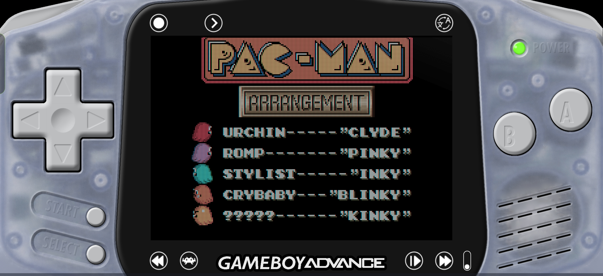
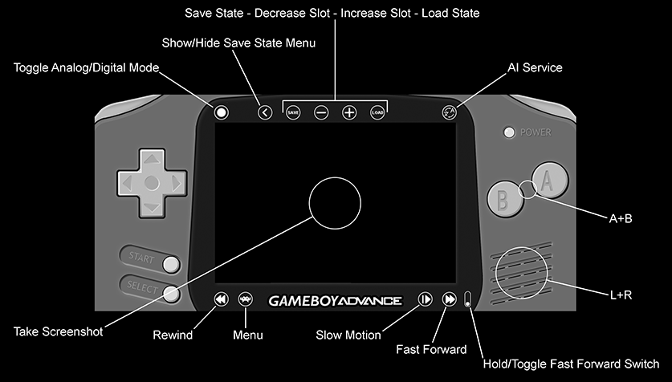

# Game Boy Advance Overlay for RetroArch

A GBA overlay for RetroArch on 20:9 Android devices, based on MaestroSistema's original GameBoy Advance Overlay.

## What's changed

- Enlarged the D-pad and its touch targets.
- Removed the combined-direction touch zones to reduce accidental inputs and improve directional accuracy.
- Added a realistic frosted GBA shell preset, available as `gba_artic_frosted.cfg`.

## Installation

1. [Download this fork as a ZIP](https://github.com/qyouz/GameBoy-Advance-Overlay/archive/refs/heads/main.zip) and extract it.
2. Copy the extracted `.cfg` and `.png` files into a `gba` folder under `RetroArch/overlays/misc`, or under the overlay directory you configured in RetroArch. Keep the presets and their images in the same folder.
3. Open RetroArch and start a GBA game. The original author recommends the mGBA core. Set the following options in the RetroArch menu.

   | Menu | Setting | Value |
   | --- | --- | --- |
   | Video | Enable Fullscreen Over Notch in Android Devices | On |
   | Video → Scaling | Integer Scale | On |
   | Video → Scaling | Aspect Ratio | Custom |
   | Video → Scaling | Custom Aspect Ratio (Width) | 1200 (5×) |
   | Video → Scaling | Custom Aspect Ratio (Height) | 800 (5×) |
   | Video → Scaling | Crop Overscan (Restart Required) | On |
   | On-Screen Display → On-Screen Overlay | Display Overlay | On |
   | On-Screen Display → On-Screen Overlay | Auto-Scale Overlay | Off |
   | On-Screen Display → On-Screen Overlay | Overlay Preset | Select a `.cfg` file from the `gba` folder |
   | On-Screen Display → On-Screen Overlay | Overlay Opacity | 1.00 |
   | On-Screen Display → On-Screen Overlay | (Landscape) Overlay Scale | 1.000 |

   Choose `gba_artic.cfg`, `gba_black.cfg`, `gba_orange.cfg`, `gba_purple.cfg`, or `gba_artic_frosted.cfg`.

4. Open **Quick Menu → Overrides → Save Core Overrides**, then restart RetroArch.

These settings are intended for 20:9 displays at 2400 × 1080. Other aspect ratios and resolutions may require adjustments.

### Optional settings

The original author suggests these mGBA core options.

- **Use BIOS File if Found (Restart)** — On, if you have a BIOS file
- **Skip BIOS Intro (Restart)** — Off
- **Color Correction** — Game Boy Advance
- **Interframe Blending** — LCD Ghosting (Accurate)
- **Low Pass Filter** — On

The original author also suggests the `dot.glslp` video shader in `shaders_glsl/handheld/`, or `dot.slangp` in `shaders_slang/handheld/` when using Vulkan.

## Usage

Tap the Game Boy Advance logo to hide or show the function buttons. The buttons still respond to touch when hidden. Configure Rewind and AI Service in RetroArch to use their overlay shortcuts.

## Credits

- Original overlay by MaestroSistema. [Original project](https://github.com/maestrosistema/GameBoy-Advance-Overlay)
- Modified by Qyouz.
- Special thanks to the RetroArch team.

Game Boy is a trademark of Nintendo Co., Ltd. Android is a trademark of Google LLC.
